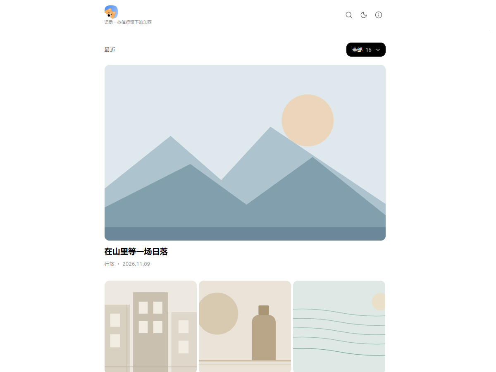

# Bang

> 落笔有声，留白有度。

Bang 是一款为写作者打造的开源 WordPress 主题。纯白底、黑字、零打扰——把注意力还给内容本身。点开卡片就地展开、换页不白屏、手机上滑出侧栏，动效全都长在内容里。

永久免费 · 完全开源 · 无需授权 · 更新不收费。

## 为什么是 Bang

- **永久免费，完全开源**：不收费、不订阅、不设 Pro 版。遵循 GPL v2.0 及以上协议，个人博客与商业站点都能免费用，不绑域名、不限站点数量。
- **源码全部开放**：PHP、CSS、JS 全部可查可改，没有加密、混淆或远程校验。
- **零 CDN 依赖**：图标、字体、灯箱组件全部本地化，断网也能完整呈现。
- **移动端优先**：从卡片流到阅读层，每一步交互都为小屏设计。

## 主题特性

| # | 特性 | 说明 |
|---|------|------|
| 01 | 共享元素转场 | 点开卡片就地展开成阅读层，关掉缩回原位。没有整页跳转，视线不丢。 |
| 02 | 全站 PJAX 无刷新 | Swup 接管站内跳转，换页只换内容区；进度条与淡入让等待有反馈。 |
| 03 | 移动端侧栏抽屉 | 顶栏一个按钮滑出完整侧栏，遮罩、ESC、点链接都会收起，个人中心自动隐藏。 |
| 04 | PhotoSwipe 沉浸灯箱 | 本地化集成，半透明背景保留上下文，图注与缩略图当前态同步。 |
| 05 | ⌘K 命令面板 | 搜索与命令合一，键盘优先，可选接入 AI 语义搜索。 |
| 06 | 整卡压图幻灯片 | 手机上封面铺满整卡，标题与按钮压在磨砂玻璃条上，左右滑即翻篇。 |

## 功能一览

除了上面的招牌交互，Bang 还内置了完整的内容站能力，开箱即用：

- **用户系统**：前台登录 / 注册、个人中心、资料与头像设置、信任设备管理。
- **评论与审核**：两级嵌套评论、违禁词自动审核（词库放 `inc/data` 下 `.txt` 即自动识别，支持权重与 reject / hold / mask 动作）。
- **人机校验**：自研滑块 + 极验 v4 双模式，服务端签发挑战、绑定来源 IP、失败与成功双向限流。
- **内容解锁**：点赞 / 评论 / 密码 / 入群四种方式，可整篇锁定，也可对单个区块锁定；配套 WeBot 机器人插件对接。
- **说说（轻博客）**：独立 `pk_say` 内容类型，卡片流展示，带点赞与点赞人头像。
- **友链与申请**：基于 WordPress 核心链接管理器，支持分类、申请表单与邮件通知。
- **站点设置**：后台六大设置面板（常规 / 安全 / 邮件 / SEO / 解锁 / 高级），SMTP 发信、自定义时区、深浅色 Logo、站点图标。
- **信息页面**：关于、联系、帮助、归档、分类、隐私政策、用户协议等页面模板齐备。
- **内容区块**：提示、折叠、代码、解锁四类 Gutenberg 区块及对应简码。
- **阅读体验**：文章目录、阅读进度条、正文关键词高亮、扫光换页、返回顶部、手势翻篇。

## 技术信息

| 项目 | 规格 |
|------|------|
| 主题版本 | V0.13.27 |
| 主题价格 | 永久免费，无付费版本 |
| 开源协议 | GPL v2.0 及以上 |
| WordPress | 6.0 及以上 |
| PHP | 7.4 至 8.3 |
| 浏览器 | Edge、Firefox、Safari、Chrome 等现代浏览器 |
| 主题类型 | 轻量响应式博客主题 |
| 授权方式 | 无需授权码、不绑定域名、不限站点数量 |

## 安装与使用

1. 从 [Releases](https://github.com/naigoucn/bang/releases/latest) 下载最新版 ZIP。
2. 进入 WordPress 后台 → 外观 → 主题 → 添加新主题 → 上传主题，选择 ZIP 安装。
3. 启用主题后，到「外观 → 自定义 / 主题设置」按需配置菜单、Logo、SEO、安全等选项。
4. 如需演示数据或完整功能体验，可参考主题目录下的页面模板自行建立对应页面。

建议通过**子主题**做二次开发，避免直接改动父主题源代码导致升级困难。

## 二次开发与分发

源代码依 GPL v2.0 及以上协议开放，可自由修改与再分发；衍生作品请沿用相同协议并保留原作者版权声明。欢迎提 Issue、发 PR、做子主题。改得好看，记得回传一份。

## 注意事项

- 建议通过子主题做二次开发，因直接改动父主题源代码导致的数据丢失等问题，请自行排查。
- 演示站点中的图片、音视频等内容均为演示用途，版权归原作者所有。
- 开源软件按「现状」提供，不附带任何明示或默示担保，请自行做好站点与数据库备份。

## 相关链接

- 项目主页：<https://github.com/naigoucn/bang>
- 下载最新版：<https://github.com/naigoucn/bang/releases/latest>
- 问题反馈：<https://github.com/naigoucn/bang/issues>

## 许可证

[GPL v2.0 or later](https://www.gnu.org/licenses/old-licenses/gpl-2.0.html)
